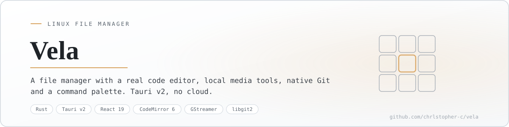
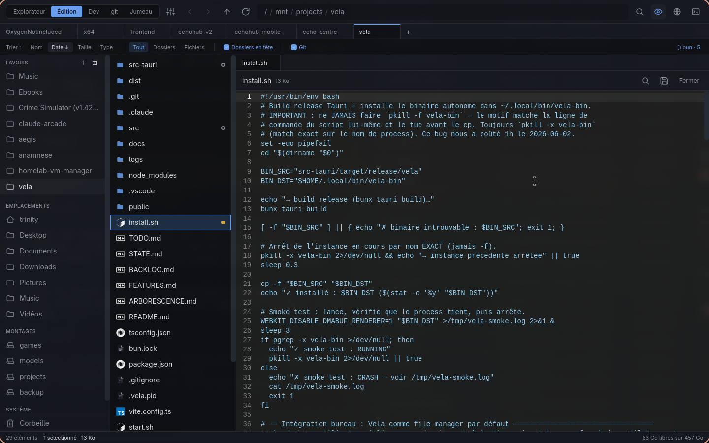
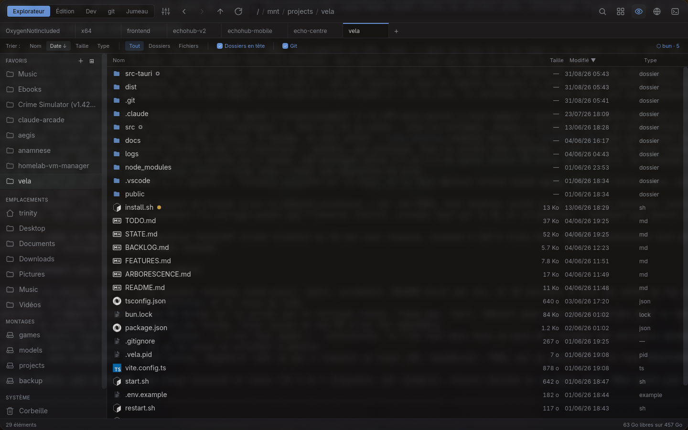
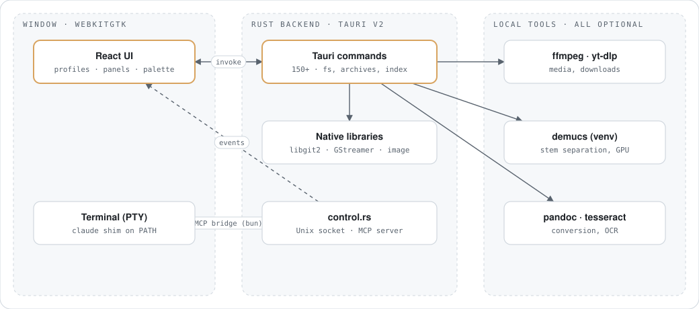
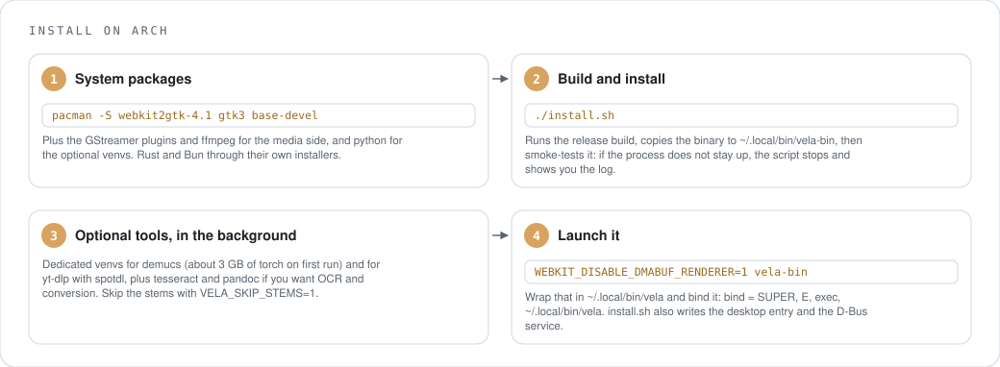
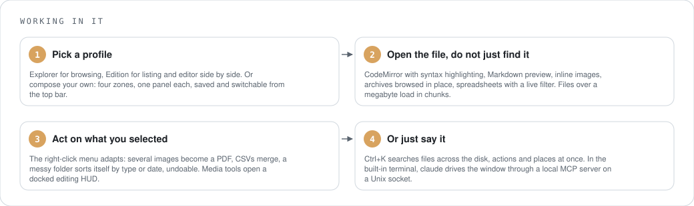
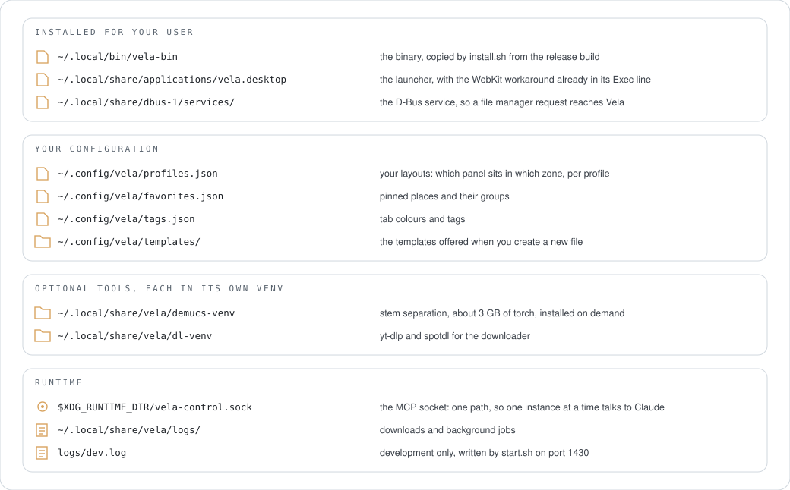
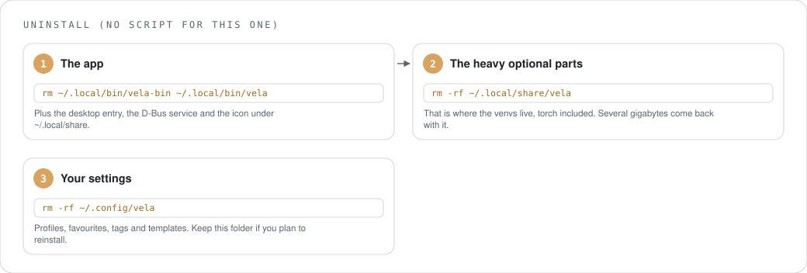
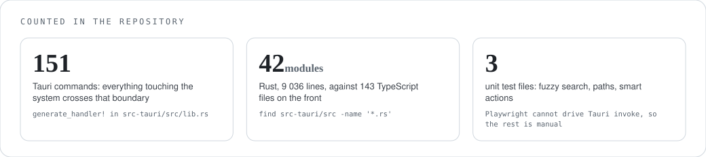
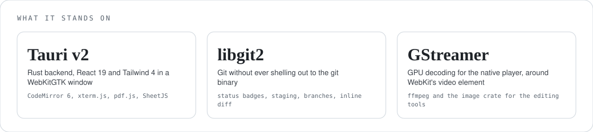

<p align="center">
  <picture>
    <source media="(prefers-color-scheme: dark)" srcset="docs/readme/banner-dark.svg">
    
  </picture>
</p>

<p align="center"><sub>English · <a href="#version-française">Version française</a></sub></p>

# Vela

A file manager for Linux that also opens the file. Nemo never got a preview pane, so Vela puts a real code editor next to the listing, and adds local media tools, native Git, a command palette and a built-in browser. Tauri v2, and nothing it does needs a network.

> Status: v2.9, my daily driver. 151 Tauri commands behind the interface. Last active June 2026.

<p align="center">
  
</p>
<p align="center"><sub>The Edition profile: listing and CodeMirror side by side, Git status dots on the files, tabs across the top.</sub></p>

## What makes it different

Every window is a **profile**: you decide what sits left, centre, right and bottom among favourites, listing, editor, tree and terminal, then switch profiles from the top bar. Explorer and Edition come built in.

The parts a stock file manager does not have:

- **An editor.** CodeMirror 6 with highlighting for the usual languages, `Ctrl+S`, `Ctrl+F`, Markdown preview, inline images, archives browsed in place (zip, tar.\*, rar, 7z), spreadsheets with a live filter, and files over a megabyte loaded in chunks so nothing freezes.
- **Media tools with no timeline.** Crop, rotate, resize and adjust images; cut, fade, normalise and convert audio; cut, compress and extract from video. Stem separation with demucs when you want it, on the GPU if there is one. All local, through ffmpeg and the Rust `image` crate.
- **Git without the `git` binary.** libgit2 gives status dots in the listing, a panel with staging, commit, branches and history, and an inline diff between HEAD and disk.
- **A command palette** (`Ctrl+K`) that searches files across the whole disk through a background index, actions and places at once.
- **A browser.** Multi-tab WebKit with sessions kept between launches, and one button to wipe everything.
- **A downloader** for YouTube and Spotify links through yt-dlp and spotdl, playlists included, with progress per item.
- **Conversion of almost anything**: images to PDF with nothing installed, documents through pandoc, office files through LibreOffice. Missing tool, missing menu entry, no error.
- **An agent hook.** Run `claude` in the built-in terminal and Claude Code drives the window through a local MCP server on a Unix socket: open a file, show a diff, navigate, preview generated content. The shim exists only inside Vela's terminal, and your global Claude config is untouched.

<p align="center">
  
</p>
<p align="center"><sub>The Explorer profile: favourites, XDG places and mounts on the left, sortable listing with per-format icons, free space at the bottom.</sub></p>

## How it works

<p align="center">
  <picture>
    <source media="(prefers-color-scheme: dark)" srcset="docs/readme/how-it-works-dark.svg">
    
  </picture>
</p>

The window is a WebKitGTK webview running React. Everything touching the system is a Rust command on the Tauri side: filesystem, archives, the search index, libgit2, GStreamer for playback, the `image` crate for edits. Heavier jobs run as subprocesses, and each one is optional. The terminal is a real PTY; typing `claude` in it starts a small Bun bridge that speaks MCP to the app over a Unix socket.

## Install

<p align="center">
  <picture>
    <source media="(prefers-color-scheme: dark)" srcset="docs/readme/install-dark.svg">
    
  </picture>
</p>

```sh
sudo pacman -S webkit2gtk-4.1 gtk3 base-devel gst-plugins-base gst-plugins-good gst-plugins-bad gst-libav ffmpeg python
curl -fsSL https://bun.sh/install | bash
curl --proto '=https' --tlsv1.2 -sSf https://sh.rustup.rs | sh

git clone https://github.com/Chrlstopher-c/vela && cd vela
bun install && ./install.sh
```

Development: `./start.sh` runs `tauri dev` on port 1430, with logs in `logs/dev.log`.

## Use

<p align="center">
  <picture>
    <source media="(prefers-color-scheme: dark)" srcset="docs/readme/usage-dark.svg">
    
  </picture>
</p>

## Where things live

<p align="center">
  <picture>
    <source media="(prefers-color-scheme: dark)" srcset="docs/readme/files-dark.svg">
    
  </picture>
</p>

## Uninstall

<p align="center">
  <picture>
    <source media="(prefers-color-scheme: dark)" srcset="docs/readme/uninstall-dark.svg">
    
  </picture>
</p>

## Counted

<p align="center">
  <picture>
    <source media="(prefers-color-scheme: dark)" srcset="docs/readme/counted-dark.svg">
    
  </picture>
</p>

## What it stands on

<p align="center">
  <picture>
    <source media="(prefers-color-scheme: dark)" srcset="docs/readme/deps-dark.svg">
    
  </picture>
</p>

## Help

| Symptom | Cause | Fix |
|---|---|---|
| Blank window or a crash at launch (Nvidia, Wayland) | WebKitGTK's DMABUF renderer | `WEBKIT_DISABLE_DMABUF_RENDERER=1`, already in the wrapper and the desktop entry |
| The first stem separation takes forever | demucs is downloading torch, about 3 GB | wait once, or skip stems with `VELA_SKIP_STEMS=1 ./install.sh` |
| Video in the built-in browser looks software-rendered | it is, deliberately: GPU compositing in those webviews crashed | the native player still decodes on the GPU through GStreamer |
| Folders with thousands of entries feel slow | WebKitGTK renders the listing where GTK widgets would be faster | known trade-off, see below |
| `pkill -f vela-bin` kills your own script | `-f` matches the script's own command line | use `pkill -x vela-bin`; that one cost an hour on 2 June |
| Two windows open, only one talks to Claude | the MCP socket has a fixed path | one instance per session for now |

## Where it stands

Vela does what a file manager does, plus the list above, and I use it every day. The honest limits: it is a webview, so it uses more memory and starts slower than Nemo or Thunar, and large directories show it. That is the price of CodeMirror, inline previews and a coherent dark theme, and I took it knowingly. Playwright cannot drive Tauri's `invoke`, so end-to-end testing is manual and the unit tests only cover fuzzy search, paths and smart actions. Spotify links resolve to a YouTube equivalent because of DRM. The UI is in French.

## Project docs

`FEATURES.md` (the full feature list with comparisons), `ARCHITECTURE.md`, `STATE.md`, `TODO.md`, `ARBORESCENCE.md`.

## Licence

No licence file yet.

---

## Version française

Un gestionnaire de fichiers Linux qui ouvre aussi le fichier. Nemo n'a jamais eu de panneau d'aperçu, alors Vela met un vrai éditeur de code à côté du listing, et ajoute des outils média locaux, Git natif, une palette de commandes et un navigateur intégré. Tauri v2, et rien de ce qu'il fait n'a besoin du réseau.

> État : v2.9, mon outil quotidien. 151 commandes Tauri derrière l'interface. Dernière activité : juin 2026.

<p align="center">
  
</p>
<p align="center"><sub>Le profil Édition : listing et CodeMirror côte à côte, pastilles d'état Git sur les fichiers, onglets en haut.</sub></p>

### Ce qui le distingue

Chaque fenêtre est un **profil** : tu décides ce qui occupe la gauche, le centre, la droite et le bas parmi favoris, listing, éditeur, arborescence et terminal, puis tu bascules depuis la barre du haut. Explorateur et Édition sont fournis.

Ce qu'un gestionnaire de fichiers classique n'a pas :

- **Un éditeur.** CodeMirror 6 avec coloration pour les langages usuels, `Ctrl+S`, `Ctrl+F`, aperçu Markdown, images en ligne, archives explorées sur place (zip, tar.\*, rar, 7z), tableurs avec filtre live, et fichiers de plus d'un mégaoctet chargés par morceaux pour que rien ne fige.
- **Des outils média sans timeline.** Recadrer, pivoter, redimensionner et ajuster une image ; découper, fondre, normaliser et convertir de l'audio ; découper, compresser et extraire d'une vidéo. Séparation de stems avec demucs quand tu veux, sur le GPU s'il y en a un. Tout en local, via ffmpeg et la crate Rust `image`.
- **Git sans le binaire `git`.** libgit2 donne les pastilles d'état dans le listing, un panneau avec index, commit, branches et historique, et un diff inline entre HEAD et le disque.
- **Une palette de commandes** (`Ctrl+K`) qui cherche en même temps dans les fichiers de tout le disque via un index de fond, dans les actions et dans les emplacements.
- **Un navigateur.** WebKit multi-onglets avec sessions conservées entre les lancements, et un bouton pour tout effacer.
- **Un téléchargeur** pour les liens YouTube et Spotify via yt-dlp et spotdl, playlists comprises, avec progression par morceau.
- **La conversion de presque tout** : images vers PDF sans rien installer, documents via pandoc, bureautique via LibreOffice. Outil absent, entrée de menu absente, pas d'erreur.
- **Une prise pour l'agent.** Lance `claude` dans le terminal intégré et Claude Code pilote la fenêtre par un serveur MCP local sur socket Unix : ouvrir un fichier, montrer un diff, naviguer, prévisualiser un contenu généré. Le shim n'existe que dans le terminal de Vela, et ta config Claude globale n'est pas touchée.

<p align="center">
  
</p>
<p align="center"><sub>Le profil Explorateur : favoris, emplacements XDG et montages à gauche, listing triable avec icônes par format, espace libre en bas.</sub></p>

### Comment ça marche

<p align="center">
  <picture>
    <source media="(prefers-color-scheme: dark)" srcset="docs/readme/how-it-works-dark.svg">
    
  </picture>
</p>

La fenêtre est une webview WebKitGTK qui exécute React. Tout ce qui touche au système est une commande Rust côté Tauri : système de fichiers, archives, index de recherche, libgit2, GStreamer pour la lecture, la crate `image` pour les retouches. Les travaux lourds tournent en sous-processus, et chacun est optionnel. Le terminal est un vrai PTY ; y taper `claude` démarre un petit pont Bun qui parle MCP à l'app par un socket Unix.

### Installation

<p align="center">
  <picture>
    <source media="(prefers-color-scheme: dark)" srcset="docs/readme/install-dark.svg">
    
  </picture>
</p>

```sh
sudo pacman -S webkit2gtk-4.1 gtk3 base-devel gst-plugins-base gst-plugins-good gst-plugins-bad gst-libav ffmpeg python
curl -fsSL https://bun.sh/install | bash
curl --proto '=https' --tlsv1.2 -sSf https://sh.rustup.rs | sh

git clone https://github.com/Chrlstopher-c/vela && cd vela
bun install && ./install.sh
```

Développement : `./start.sh` lance `tauri dev` sur le port 1430, journaux dans `logs/dev.log`.

### Utilisation

<p align="center">
  <picture>
    <source media="(prefers-color-scheme: dark)" srcset="docs/readme/usage-dark.svg">
    
  </picture>
</p>

### Où sont les choses

<p align="center">
  <picture>
    <source media="(prefers-color-scheme: dark)" srcset="docs/readme/files-dark.svg">
    
  </picture>
</p>

### Désinstallation

<p align="center">
  <picture>
    <source media="(prefers-color-scheme: dark)" srcset="docs/readme/uninstall-dark.svg">
    
  </picture>
</p>

### Compté

<p align="center">
  <picture>
    <source media="(prefers-color-scheme: dark)" srcset="docs/readme/counted-dark.svg">
    
  </picture>
</p>

### Sur quoi ça repose

<p align="center">
  <picture>
    <source media="(prefers-color-scheme: dark)" srcset="docs/readme/deps-dark.svg">
    
  </picture>
</p>

### Aide

| Symptôme | Cause | Remède |
|---|---|---|
| Fenêtre blanche ou plantage au lancement (Nvidia, Wayland) | le renderer DMABUF de WebKitGTK | `WEBKIT_DISABLE_DMABUF_RENDERER=1`, déjà dans le wrapper et dans l'entrée de bureau |
| La première séparation de stems n'en finit pas | demucs télécharge torch, environ 3 Go | attends une fois, ou saute les stems avec `VELA_SKIP_STEMS=1 ./install.sh` |
| La vidéo du navigateur intégré semble rendue en logiciel | c'est le cas, volontairement : le compositing GPU de ces webviews plantait | le lecteur natif décode toujours sur le GPU via GStreamer |
| Les dossiers à plusieurs milliers d'entrées traînent | WebKitGTK rend le listing là où des widgets GTK seraient plus rapides | compromis assumé, voir plus bas |
| `pkill -f vela-bin` tue ton propre script | `-f` matche aussi la ligne de commande du script | utilise `pkill -x vela-bin` ; celui-là a coûté une heure le 2 juin |
| Deux fenêtres ouvertes, une seule parle à Claude | le socket MCP a un chemin fixe | une instance par session pour l'instant |

### Où ça en est

Vela fait ce que fait un gestionnaire de fichiers, plus la liste ci-dessus, et je m'en sers tous les jours. Les limites honnêtes : c'est une webview, donc plus de mémoire et un démarrage plus lent que Nemo ou Thunar, et les gros dossiers le montrent. C'est le prix de CodeMirror, des aperçus en ligne et d'un thème sombre cohérent, et je l'ai payé en connaissance de cause. Playwright ne sait pas piloter l'`invoke` de Tauri, donc les tests de bout en bout sont manuels et les tests unitaires ne couvrent que la recherche floue, les chemins et les actions intelligentes. Les liens Spotify se résolvent vers un équivalent YouTube à cause du DRM.

### Documentation du projet

`FEATURES.md` (la liste complète avec comparatifs), `ARCHITECTURE.md`, `STATE.md`, `TODO.md`, `ARBORESCENCE.md`.

### Licence

Pas encore de fichier de licence.
